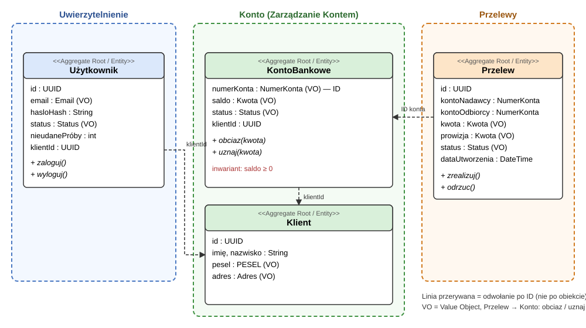

# Zadanie 1 – Domain Driven Design

## Opis zadania

Zadanie polega na zamodelowaniu fragmentu bezpiecznej aplikacji bankowej z wykorzystaniem zasad Domain Driven Design. Model obejmuje trzy konteksty ograniczone (Bounded Context): **Konto**, **Przelewy** oraz **Uwierzytelnienie**. W każdym z nich wyodrębniono agregaty, encje i obiekty wartości (łącznie 4 encje będące korzeniami agregatów). Model jest celowo uproszczony – nie obejmuje m.in. kredytów, hipotek ani operacji w bankomatach.

## Model

Linie przerywane oznaczają odwołania **po identyfikatorze** (agregaty nie trzymają bezpośrednich referencji do innych agregatów).

## Konteksty (Bounded Contexts)

| Kontekst | Odpowiedzialność | Agregaty |
|---|---|---|
| **Konto** (Zarządzanie Kontem) | Rachunek bankowy, saldo, właściciel rachunku | `KontoBankowe`, `Klient` |
| **Przelewy** | Zlecanie i realizacja przelewów między rachunkami | `Przelew` |
| **Uwierzytelnienie** | Logowanie, weryfikacja tożsamości, blokada dostępu | `Uzytkownik` |

## Agregaty, encje i obiekty wartości

### Kontekst Konto

**KontoBankowe** – korzeń agregatu (encja, ID = `numerKonta`)

| Atrybut | Typ | Opis |
|---|---|---|
| numerKonta | `NumerKonta` (VO) | Identyfikator rachunku |
| saldo | `Kwota` (VO) | Aktualne saldo |
| status | `Status` (VO) | `Aktywne` / `Zablokowane` |
| klientId | UUID | Odwołanie do właściciela (po ID) |

Operacje: `obciaz(kwota)`, `uznaj(kwota)`.

**Klient** – korzeń agregatu (encja, ID = UUID)

| Atrybut | Typ | Opis |
|---|---|---|
| id | UUID | Unikalny identyfikator |
| imię, nazwisko | String | Obowiązkowe |
| pesel | `PESEL` (VO) | Obowiązkowy, unikalny |
| adres | `Adres` (VO) | Obowiązkowy |

### Kontekst Przelewy

**Przelew** – korzeń agregatu (encja, ID = UUID)

| Atrybut | Typ | Opis |
|---|---|---|
| id | UUID | Identyfikator przelewu |
| kontoNadawcy | `NumerKonta` | Rachunek obciążany (po ID) |
| kontoOdbiorcy | `NumerKonta` | Rachunek uznawany (po ID) |
| kwota | `Kwota` (VO) | Kwota przelewu |
| prowizja | `Kwota` (VO) | Prowizja za przelew |
| status | `Status` (VO) | `Oczekujący` / `Zrealizowany` / `Odrzucony` |
| dataUtworzenia | DateTime | Data utworzenia (audyt) |

Operacje: `zrealizuj()`, `odrzuc()`.

### Kontekst Uwierzytelnienie

**Uzytkownik** – korzeń agregatu (encja, ID = UUID)

| Atrybut | Typ | Opis |
|---|---|---|
| id | UUID | Identyfikator |
| email | `Email` (VO) | Login, unikalny |
| hasloHash | String | Hash hasła (hasło nigdy nie jest przechowywane jawnie) |
| status | `Status` (VO) | `Aktywny` / `Zablokowany` |
| nieudanePróby | int | Licznik błędnych logowań z rzędu |
| klientId | UUID | Odwołanie do `Klient` (po ID) |

Operacje: `zaloguj()`, `wyloguj()`.

### Klient a Użytkownik

`Klient` i `Uzytkownik` to dwa różne agregaty w dwóch różnych kontekstach. Ta sama osoba jest modelowana inaczej w zależności od kontekstu.

| | Klient | Uzytkownik |
|---|---|---|
| Czym jest | Osoba – właściciel rachunku | Konto dostępowe do systemu (sposób zalogowania) |
| Kontekst | Konto | Uwierzytelnienie |
| Pytanie, na które odpowiada | „Kto jest właścicielem rachunku?” | „Kto się zalogował i jak to udowodnił?” |
| Dane | imię, nazwisko, PESEL, adres | email, hash hasła, status, licznik nieudanych prób |
| Zmienia się, gdy | zmieni się adres, nazwisko | zmieni się hasło, nastąpi blokada |

Powiązanie: `Uzytkownik.klientId` wskazuje na `Klient.id` (po identyfikatorze). Rozdzielenie jest celowe: blokada logowania nie zmienia danych osobowych ani rachunków, a zmiana adresu nie dotyka hasła. Autoryzacja przelewu polega na porównaniu `Uzytkownik.klientId` z `KontoBankowe.klientId` rachunku nadawcy.

### Obiekty wartości (Value Objects)

Obiekty wartości są niezmienne, nie mają tożsamości i są porównywane po wartości.

| Obiekt wartości | Format / ograniczenia |
|---|---|
| **Kwota** | Decimal (nie float), 2 miejsca po przecinku, waluta wyłącznie PLN |
| **NumerKonta** | IBAN polski: `PL` + 26 cyfr (łącznie 28 znaków), np. `PL61109010140000071219812874` |
| **Email** | Format `nazwa@domena.strefa`, jeden znak `@`, bez spacji, max 254 znaki, bez rozróżniania wielkości liter, unikalny |
| **PESEL** | Dokładnie 11 cyfr, ostatnia cyfra kontrolna, unikalny |
| **Adres** | `ulica` (niepusta, max 100), `numerDomu` (niepusty, np. `12A`, `5/7`), `kodPocztowy` (`XX-XXX`), `miasto` (litery, max 50); wszystkie pola obowiązkowe |
| **Status** | Wartość z zamkniętego zbioru zależnego od agregatu (patrz niżej) |

## Przyjęte założenia

### Ogólne
- Wszystkie kwoty są w **złotych (PLN)**; w modelu nie ma przewalutowań.
- Kwoty są typu **Decimal** z dokładnością do 2 miejsc po przecinku.
- Rachunek ma **dokładnie jednego właściciela**.
- Agregaty odwołują się do siebie **wyłącznie po identyfikatorze**.
- Jedna transakcja modyfikuje jeden agregat.
- Poza zakresem modelu: kredyty i hipoteki, bankomaty, odblokowanie konta (odbywa się poza modelem, np. kontakt z bankiem), uwierzytelnianie dwuskładnikowe.

### Niezmienniki (inwarianty)

| Agregat | Reguła |
|---|---|
| KontoBankowe | `saldo ≥ 0` – brak debetu |
| KontoBankowe | Konto `Zablokowane` nie może być obciążane **ani uznawane** |
| KontoBankowe | Rachunek ma dokładnie jednego właściciela (`klientId` obowiązkowe) |
| Przelew | `kwota > 0` (zero i wartości ujemne są niedozwolone) |
| Przelew | Nadawca i odbiorca są obowiązkowi i **nie mogą być tym samym rachunkiem** |
| Przelew | Waluta wyłącznie PLN |
| Przelew | Przejścia statusu: `Oczekujący → Zrealizowany` lub `Oczekujący → Odrzucony`; ze statusów końcowych nie ma wyjścia |
| Uzytkownik | Hasło: minimum 16 znaków, co najmniej jedna cyfra, jedna wielka i jedna mała litera; przechowywany wyłącznie hash |
| Uzytkownik | Email jest unikalny |
| Uzytkownik | Po **3** nieudanych logowaniach z rzędu status zmienia się na `Zablokowany`; poprawne logowanie zeruje licznik |
| Uzytkownik | Użytkownik `Zablokowany` nie może się zalogować |
| Klient | PESEL i imię/nazwisko oraz adres są obowiązkowe; PESEL unikalny |

### Statusy

| Agregat | Dozwolone statusy |
|---|---|
| KontoBankowe | `Aktywne`, `Zablokowane` |
| Przelew | `Oczekujący`, `Zrealizowany`, `Odrzucony` |
| Uzytkownik | `Aktywny`, `Zablokowany` |

## Integracja pomiędzy kontekstami

| Od | Do | Operacja / zależność |
|---|---|---|
| Uwierzytelnienie → Konto | `Uzytkownik.klientId` = `Klient.id` | Użytkownik jest powiązany z klientem; klient jest właścicielem rachunku |
| Uwierzytelnienie → Przelewy | Autoryzacja zlecenia | Przelew może zlecić tylko zalogowany użytkownik, i tylko z rachunku, którego `klientId` = `Uzytkownik.klientId` |
| Przelewy → Konto | `obciaz(kwota)` na koncie nadawcy | Wywoływane przy realizacji przelewu |
| Przelewy → Konto | `uznaj(kwota)` na koncie odbiorcy | Wywoływane po udanym obciążeniu |

### Przebieg przelewu

1. Użytkownik loguje się (kontekst **Uwierzytelnienie**).
2. Tworzony jest `Przelew` w statusie `Oczekujący`; sprawdzane jest, czy rachunek nadawcy należy do użytkownika.
3. `Przelewy` wywołuje w kontekście **Konto**: `obciaz` (nadawca), następnie `uznaj` (odbiorca).
4. Wynik:
   - sukces → `Przelew` ma status `Zrealizowany`;
   - odmowa (brak środków, konto nadawcy lub odbiorcy `Zablokowane`) → `Przelew` ma status `Odrzucony`.

Obciążenie i uznanie wykonywane są jako **jedna operacja logiczna**: albo obie się powiodą, albo żadna (w razie niepowodzenia uznania obciążenie jest wycofywane).
